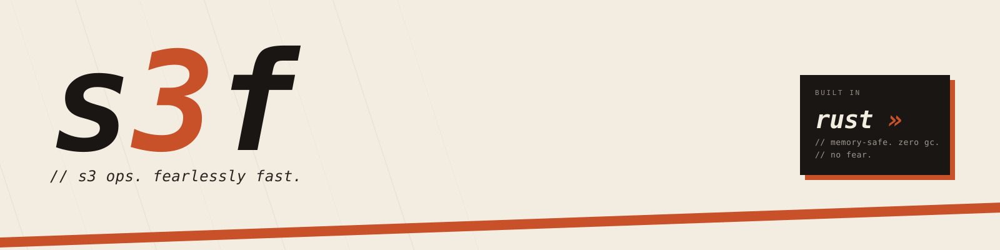
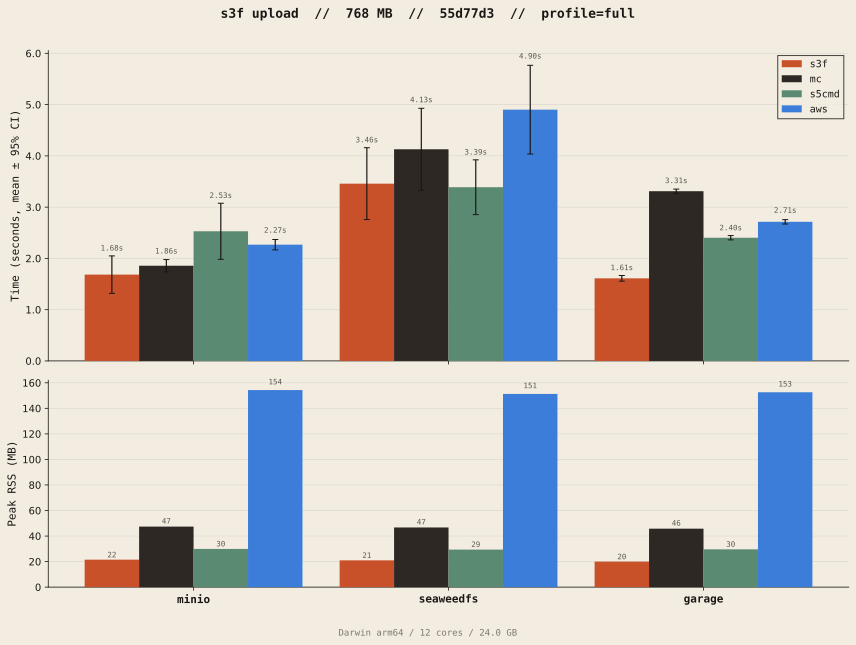
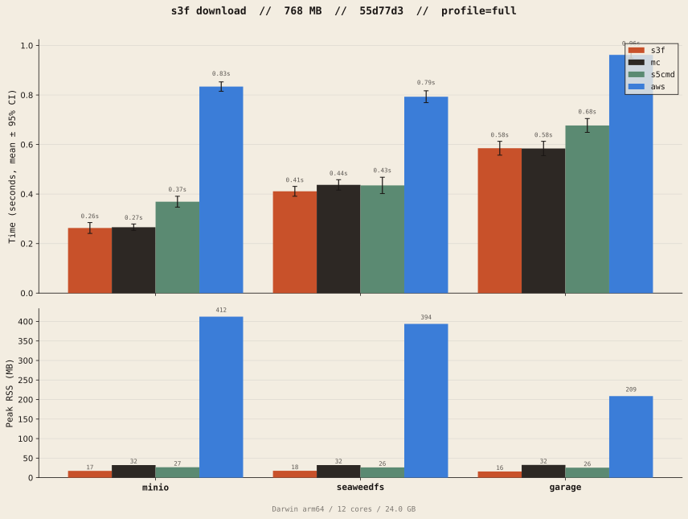
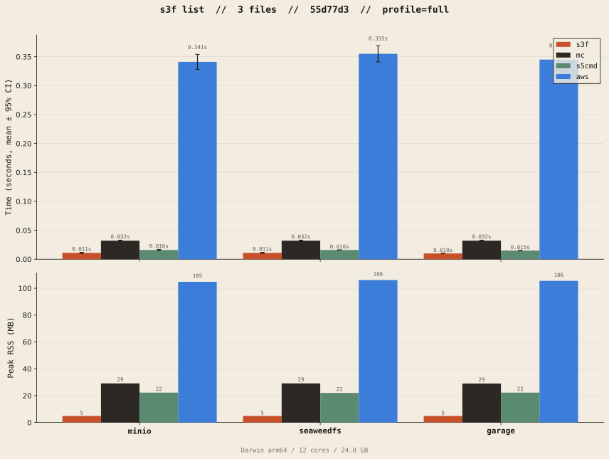

<p align="center">
  <picture>
    <source media="(prefers-color-scheme: dark)" srcset="public/banner-dark.svg">
    <source media="(prefers-color-scheme: light)" srcset="public/banner-cream.svg">
    
  </picture>
</p>

<p align="center">
  <strong>S3 ops, but fearlessly fast.</strong><br>
  <sub>S3 client and CLI in Rust, with Python and Node.js bindings.</sub>
</p>

---

s3f moves files to and from S3 with as little overhead as possible. It talks to
S3 over plain HTTP with SigV4 signing instead of going through the AWS SDK, and
transfers files in parallel by streaming them in parts. Memory stays flat no
matter how big the files are.

It works with AWS S3 and S3-compatible stores such as MinIO, Garage, and
SeaweedFS.

## Features

### Throughput

- **Parallel listing.** S3 returns keys 1,000 at a time, and each page waits
  for the one before it. s3f splits the key space into ranges, estimated from
  the keys it has already seen, and lists them concurrently. Nested
  `dir/subdir/` layouts are walked one level at a time in parallel. The result
  is the same set of keys a serial listing returns.
- **Parallel transfers at two levels.** Many files at once, and many parts per
  file. Large uploads use multipart upload. Large downloads use concurrent
  `Range` requests that write directly into place on disk. Part size and
  per-file concurrency scale with file size, within S3's 10,000-part limit.
- **Adaptive downloads.** Files from 16 MiB up to 2 GiB start as a single
  GET. If the first 8 MiB arrive slowly, the rest is split across extra
  connections, all pinned to the same `ETag` so a concurrent overwrite can't
  mix versions.
- **Connections spread across servers.** S3 limits throughput per
  connection. New connections rotate through every S3 front-end address seen
  in DNS, rather than all landing on the first one.
- **Auto-tuned downloads.** If you don't set them, worker count and per-file
  concurrency are picked from the size distribution of the objects being
  fetched.

### Reliability

- **Hedged requests.** A GET or list request that hasn't answered within the
  95th percentile of recent latency is sent again on another connection, and
  the first answer wins. In a large batch, a few stalled requests no longer
  set the finish time. Hedges are capped at 10% of requests.
- **Resumable downloads.** If a connection drops mid-download, the part
  resumes from the last byte received. Connections that stop delivering data
  time out and are retried instead of hanging.
- **Retries with backoff.** `5xx` and `429` responses are retried with
  exponential backoff and jitter.
- **Crash-safe downloads.** Data goes to a temporary file that is moved into
  place only once complete, so an interrupted run never leaves partial files.

### Footprint

- **Bounded memory.** Upload parts stream from disk instead of being held in
  RAM, so a 50 GB file needs about as much memory as a 50 MB one.
- **One core, several front ends.** The same Rust engine powers the CLI, the
  Rust crate, and the Python and Node.js packages.

## Installation

| Target  | Command                             |
| ------- | ----------------------------------- |
| CLI     | See [below](#cli)                   |
| Rust    | `cargo add s3f`                     |
| Python  | `uv add s3f` or `pip install s3f`   |
| Node.js | `npm install @lazypilottt/s3f`      |

The Node.js package also installs with pnpm, yarn, and bun.

### CLI

Prebuilt binary (macOS and Linux):

```bash
curl --proto '=https' --tlsv1.2 -LsSf https://github.com/Lazypilottt/s3f/releases/latest/download/s3f-cli-installer.sh | sh
```

From source (requires the [Rust toolchain](https://rustup.rs)):

```bash
cargo install --git https://github.com/Lazypilottt/s3f s3f-cli
```

## CLI usage

```text
s3f [GLOBAL OPTIONS] <COMMAND> [OPTIONS]

Commands:
  upload    Upload files or directories to S3
  download  Download objects from S3 to a local directory
  ls        List objects in a bucket
```

### Quick start

```bash
export AWS_ACCESS_KEY_ID=...
export AWS_SECRET_ACCESS_KEY=...

s3f upload ./data -b my-bucket -p backups/2024/     # upload a directory
s3f ls -b my-bucket -p backups/2024/                # list what's there
s3f download -b my-bucket -p backups/2024/ -d ./out # download it back
```

Against a local MinIO instance:

```bash
s3f -e http://localhost:9000 --access-key minioadmin --secret-key minioadmin \
    ls -b my-bucket
```

### Global options

These work with every command and can go before or after the subcommand.

| Flag             | Environment variable    | Description                     |
| ---------------- | ----------------------- | ------------------------------- |
| `-r, --region`   | `AWS_DEFAULT_REGION`    | Region (default `us-east-1`)    |
| `-e, --endpoint` | `AWS_ENDPOINT_URL`      | S3-compatible endpoint URL      |
| `--access-key`   | `AWS_ACCESS_KEY_ID`     | Access key ID                   |
| `--secret-key`   | `AWS_SECRET_ACCESS_KEY` | Secret access key               |
| `-q, --quiet`    | —                       | Print errors only               |

### `s3f upload`

Uploads one or more local files or directories. Directories are walked
recursively, and each file's path relative to the source becomes its key under
`--prefix`.

```bash
s3f upload ./data ./report.csv -b my-bucket -p uploads/
```

| Flag                | Default  | Description                         |
| ------------------- | -------- | ----------------------------------- |
| `<SOURCES>...`      | required | Files or directories to upload      |
| `-b, --bucket`      | required | Destination bucket                  |
| `-p, --prefix`      | `""`     | Key prefix to upload under          |
| `-w, --workers`     | `32`     | Files uploaded in parallel          |
| `-c, --concurrency` | `8`      | Parts uploaded in parallel per file |

Files larger than 50 MiB are sent with multipart upload.

### `s3f download`

Downloads every object under a prefix into a local directory, keeping the key
structure.

```bash
s3f download -b my-bucket -p uploads/ -d ./out
```

| Flag                | Default  | Description                           |
| ------------------- | -------- | ------------------------------------- |
| `-b, --bucket`      | required | Source bucket                         |
| `-p, --prefix`      | `""`     | Key prefix to download                |
| `-d, --dest`        | `.`      | Local destination directory           |
| `-w, --workers`     | auto     | Files downloaded in parallel          |
| `-c, --concurrency` | auto     | Parts downloaded in parallel per file |

If `--workers` and `--concurrency` are left out, s3f lists the prefix first and
picks values based on the object sizes: many single-request workers for lots
of small files, fewer workers with more parts each for large ones.

### `s3f ls`

Lists objects under a prefix, sorted by key, with their size and
last-modified date, followed by a total.

```bash
s3f ls -b my-bucket -p uploads/
```

| Flag            | Default  | Description                              |
| --------------- | -------- | ---------------------------------------- |
| `-b, --bucket`  | required | Bucket to list                           |
| `-p, --prefix`  | `""`     | Key prefix to filter                     |
| `-w, --workers` | `32`     | Concurrent list requests (`1` = serial)  |

## Library usage

Every binding exposes the same three operations: `upload`, `download`, and
`list`.

### Rust

```rust
use s3f::{Config, DownloadRequest, ListRequest, S3Client, UploadRequest, auth::CredentialSource};

#[tokio::main]
async fn main() -> s3f::error::Result<()> {
    let client = S3Client::new(Config::new("us-east-1", CredentialSource::Env)).await?;

    let uploaded = client
        .upload(UploadRequest::new(vec!["./data".into()], "my-bucket", "uploads/"))
        .await?;
    for f in &uploaded.files {
        println!("{} -> s3://{} ({} parts)", f.source.display(), f.key, f.parts);
    }

    client.download(DownloadRequest::new("my-bucket", "uploads/", "./out")).await?;

    let objects = client.list(ListRequest::new("my-bucket", "uploads/")).collect_all().await?;
    println!("{} objects", objects.len());

    Ok(())
}
```

For an S3-compatible endpoint, use `Config::with_endpoint`:

```rust
let config = Config::with_endpoint(
    "us-east-1",
    CredentialSource::Static { access_key: "...".into(), secret_key: "...".into() },
    "http://localhost:9000".into(),
);
```

Retries, hedging, and the stall timeout are set through `config.retry`.
Multipart thresholds and part size are set through `config.transfer`. List
concurrency is set per request with `ListRequest::with_concurrency`. See the
[crate docs](https://docs.rs/s3f) for the full API.

### Python

```python
from s3f import Config, CredentialSource, S3Client

client = S3Client(Config("us-east-1", CredentialSource.Env))

for r in client.upload(["./data"], "my-bucket", "uploads/"):
    print(f"{r.source} -> s3://{r.key} ({r.parts} parts)")

client.download("my-bucket", "uploads/", "./out")

for obj in client.list("my-bucket", "uploads/"):
    print(obj.key, obj.size)
```

### Node.js

```typescript
import { S3Client } from "@lazypilottt/s3f";

const client = await S3Client.create({ region: "us-east-1" });

await client.upload({ sources: ["./data"], bucket: "my-bucket", prefix: "uploads/" });
await client.download({ bucket: "my-bucket", prefix: "uploads/", destDir: "./out" });

const objects = await client.list({ bucket: "my-bucket", prefix: "uploads/" });
```

Pass `endpoint`, `accessKey`, and `secretKey` to `S3Client.create` for
S3-compatible stores.

Full example services built on each binding (Axum, FastAPI, and Elysia) are in
[`examples/`](examples).

## Authentication

Credentials come from `AWS_ACCESS_KEY_ID` and `AWS_SECRET_ACCESS_KEY`, or are
passed explicitly. Shared credential files (`~/.aws/credentials`), named
profiles, session tokens, and instance metadata are **not** supported yet.

## Benchmarks

s3f is benchmarked against [`s5cmd`](https://github.com/peak/s5cmd),
[`mc`](https://github.com/minio/mc), and the
[AWS CLI](https://aws.amazon.com/cli/) on local, resource-limited Docker
backends (MinIO, Garage, SeaweedFS). The transfer runs move 3 × 256 MB files,
and the list run reads 3 objects. Median wall time and peak memory on MinIO:

| Operation | s3f           | s5cmd         | mc            | aws-cli        |
| --------- | ------------- | ------------- | ------------- | -------------- |
| Upload    | 1.47 s, 22 MB | 1.92 s, 30 MB | 1.73 s, 47 MB | 2.29 s, 154 MB |
| Download  | 0.25 s, 17 MB | 0.37 s, 27 MB | 0.26 s, 32 MB | 0.83 s, 412 MB |
| List      | 10 ms, 5 MB   | 16 ms, 22 MB  | 32 ms, 29 MB  | 333 ms, 105 MB |

These are local, single-machine numbers (Apple Silicon, 12 cores). They show
how much overhead each client adds, not real-world S3 latency. Raw data for
every backend is in [`benchmarks/`](benchmarks).

<!-- plots are overwritten by bench:plot — do not rename -->

<p align="center">
  <picture>
    <source media="(prefers-color-scheme: dark)" srcset="plots/upload-dark.svg">
    
  </picture>
</p>

<p align="center">
  <picture>
    <source media="(prefers-color-scheme: dark)" srcset="plots/download-dark.svg">
    
  </picture>
</p>

<p align="center">
  <picture>
    <source media="(prefers-color-scheme: dark)" srcset="plots/list-dark.svg">
    
  </picture>
</p>

## Project layout

| Path                                 | Contents                          |
| ------------------------------------ | --------------------------------- |
| [`crates/core`](crates/core)         | `s3f` core library                |
| [`crates/cli`](crates/cli)           | `s3f` command-line tool           |
| [`bindings/python`](bindings/python) | Python package (PyO3)             |
| [`bindings/node`](bindings/node)     | Node.js package (napi-rs)         |
| [`examples`](examples)               | Example services (Rust, Py, TS)   |
| [`bench`](bench)                     | Benchmark harness                 |
| [`docs`](docs)                       | Documentation site                |

## Development

Tool versions are pinned in `mise.toml`, and local S3 backends run in Docker.

```bash
mise install                 # install the pinned toolchain
docker compose up -d         # MinIO :9000, SeaweedFS :9500, Garage :9700
cargo test --workspace
```

To build the CLI with request-level tracing, enable the `tracing` feature and
set `RUST_LOG`:

```bash
cargo run -p s3f-cli --features tracing -- ls -b my-bucket
```

### Benchmarking

```bash
# Inner loop: compare a change against a local baseline
mise run bench:dev        # record a baseline (MinIO only, ~3–5 min)
mise run bench:save       # save it to target/bench/baseline/ (gitignored)
# ...make changes...
mise run bench:dev
mise run bench:compare    # exits non-zero on regression

# Full run: refresh the committed reference numbers
mise run bench            # all backends and tools, ~10–15 min
mise run bench:save       # save to benchmarks/<run-id>/
mise run bench:plot       # regenerate plots/
```

Local Docker backends have almost no network latency and rarely stall, so
they don't show the effect of parallel listing, hedging, or adaptive
downloads. Those have micro-benchmarks against an in-process fake S3 that adds per-request
latency, per-connection bandwidth caps, and stalled requests:

```bash
cargo test --release -p s3f bench_ -- --ignored --nocapture
```

See [CONTRIBUTING.md](CONTRIBUTING.md) for commit conventions and pre-commit
hooks.

## License

[MIT](LICENSE)
